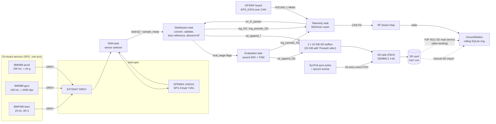
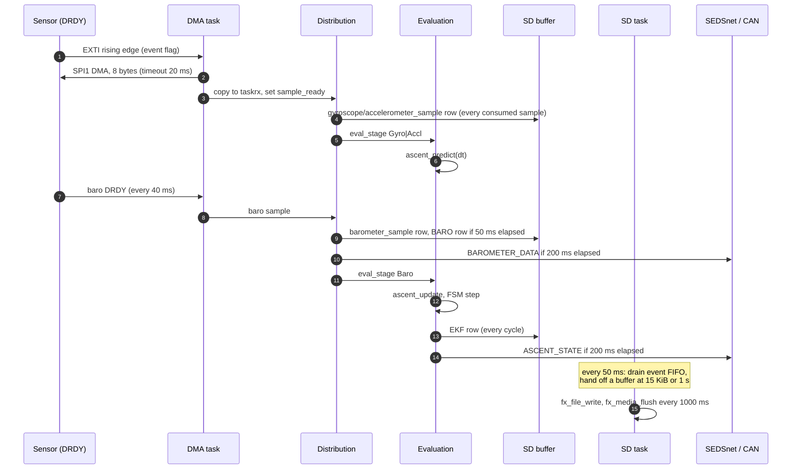

# Flight computer data pipeline

This page traces every data stream on the flight computer (FC) from the
sensor to the SD card, to the SEDSnet network and to the GroundStation (GS).
Every rate, buffer, priority and file name below comes from the source; the
file or macro is cited next to it. Values marked *derived* are computed from
cited constants, not measured. Where an older doc disagrees with the code,
the code wins and the difference is listed in [Known gaps](#9-known-gaps-and-bugs-found).

Scope: the default flight image (`./build.py`, telemetry on, TLSF allocator,
`ONBOARD_SD`, `EXTERNAL_GPS`; `CMakeLists.txt`, `build.py`). The integrated
ground test (IGT) image adds the replay stream in section 6.11.

## 1. Overview



Acquisition and logging schedule. One pass of the ascent loop is shown; on the
pad the distribution task consumes every sample instead (section 3).



Flight-phase timeline (durations not to scale except where cited):

```mermaid
gantt
  title FC acquisition and SD files across a flight
  dateFormat HH:mm:ss
  axisFormat %M:%S
  section State
  Startup / Armed (pad streaming)     :s1, 00:00:00, 50s
  Postinit (5 s, accel+baro only)     :crit, s2, 00:00:20, 5s
  Armed, countdown (~10 s, GS)        :s3, 00:00:50, 10s
  Launch..Coast (ascent EKF)          :s4, 00:01:00, 30s
  Apogee..Reefing (descent KF)        :s5, 00:01:30, 60s
  Landed (5 s sleep)                  :crit, s6, 00:02:30, 5s
  Recovery (SD logging stopped, read service on) :s7, 00:02:35, 20s
  section SD file
  irec-<t>-000.csv (ordinary)         :f1, 00:00:00, 50s
  irec_LAUNCH-<t>-000.csv             :active, f2, 00:00:50, 105s
  section IMU on SD
  100 Hz                              :i1, 00:00:00, 50s
  ~25 Hz (one per EKF cycle)          :i2, 00:00:50, 40s
  off from Apogee                     :done, i3, 00:01:30, 65s
  section Baro on SD
  25 Hz until Landed                  :b1, 00:00:00, 150s
```



## 2. Hardware, buses and interrupts

| Item | Value | Source |
| --- | --- | --- |
| MCU clock | 250 MHz (`SYSTEM_CLOCK`) | `Core/Src/tx_initialize_low_level.S` |
| Sensor bus | SPI1 master, prescaler 4, mode 0, software CS | `Core/Src/main.c` (`MX_SPI1_Init`) |
| Sensor DMA | GPDMA1 ch0 = SPI1 RX (`DMA_RECEIVER_SPI1`), ch1 = SPI1 TX | `platform.h`, `stm32h5xx_hal_msp.c` |
| Transfer | `SENSOR_BUF_SIZE` 8 bytes per read, one burst from the data register | `fccommon.h`, `dma.c` |
| DRDY lines | gyro `GYRO_EXTI_1` PB0 (EXTI0), accel `ACCL_EXTI_1` PC4 (EXTI4), baro `BARO_EXTI` PC7 (EXTI7); second lines unused for IREC 2026 | `main.h`, `fcapi.h` |
| SD card | SDMMC1, 4-bit bus, `ClockDiv` 0 from PLL1Q | `main.c`, `stm32h5xx_hal_msp.c` |
| Network | FDCAN1, FD frames without bit-rate switch, 1 Mbit/s nominal (*derived*: PLL2Q 170 MHz / 10 / 17 tq) | `main.c`, `stm32h5xx_hal_msp.c` |
| Pyro outputs | drogue `CO2_PIN` PB5, main `REEF_PIN` PB6 | `fcconfig.h` |
| GPS | none on board; fixes arrive as `GPS_DATA` from the GPS/RF board (`EXTERNAL_GPS`) | `distribution.c` |
| Magnetometer | none: no driver or stream exists in `Core/` | - |

## 3. Threads, timers, ISRs and DMA

ThreadX runs at `TX_TIMER_TICKS_PER_SECOND` 1000 (1 tick = 1 ms, `tx_user.h`).
Lower number = higher priority.

| Context | Priority | Stack | Period / trigger | Work | Source |
| --- | --- | --- | --- | --- | --- |
| Recovery task | 0 (`RECV_PRIORITY`) | 12 KiB | blocks on `seds_syscall` queue (`FC_MSG_Q_SIZE` 8), 250 ms timeout | commands, sensor (re)init, deployments, rate changes | `fctasks.h`, `recovery.c` |
| ThreadX timer thread | ThreadX default (0) | ThreadX default (1024 B) | `monotonic_checks`: first 900 ms (`TX_TIMER_INITIAL`), then every 450 ms (`TX_TIMER_TICKS`) | GS heartbeat loss (`GND_TIMEOUT` 3000 ms), GPS gap (`GPS_DELAY_MS` 200 ms) | `recovery.c`, `fcconfig.h` |
| Telemetry task | 5 (`TLMT_PRIORITY`), slice 50 | 48 KiB | CAN RX ISR or router wake flag, else 1 tick | CAN RX, discovery and `BOARD_HEALTH`, queue service (1 ms budget), `FLIGHT_STATE` republish every 2000 ms, time sync | `fctasks.h`, `telemetry.c` |
| DMA task | 5, no slice | 4096 B | DRDY event flags (1-tick poll) | picks the next ready sensor, runs one SPI1 DMA read, waits on completion (`DMA_TIMEOUT_MS` 20) | `dma.c` |
| Distribution task | 5, slice 25 | 16 KiB | `sample_ready` flags (1-tick poll) | conversion, validation, baro reference, SD/network logging, descent KF and descent FSM | `distribution.c` |
| Evaluation task | 5, slice 25, threshold 1 requested | 12 KiB | `eval_stage` flags; created suspended, resumed at Launch acceptance | ascent EKF predict/update, FSM until Apogee | `evaluation.c`, `recovery.c` (`enter_launch`) |
| SD task (`fx_app_thread`) | 5 (`FX_APP_THREAD_PRIO`), no slice | 8184 B | 50 ms waits (`(1000+19)/20` ticks), woken early by an SD read request | event FIFO, buffer hand-off, FileX writes, 1 s media flush, IGT CSV reading; SD read service (8.2), which outlives `sd_conclude` | `app_filex.c`, `sdpipeline.c` |
| EXTI0/4/7 | NVIC 0 | - | sensor DRDY | set `flags.drdy` and an event flag | `main.c`, `dma.c` |
| GPDMA1 ch0/ch1, SPI1 | NVIC 0 | - | transfer done | raise CS, post `dma_completion` | `dma.c` |
| FDCAN1 IT0/IT1 | NVIC 0 | - | CAN RX/TX | wake telemetry, TX pump | `stm32h5xx_hal_msp.c` |
| SDMMC1 | NVIC 0 | - | card I/O | FileX driver | `stm32h5xx_hal_msp.c` |
| SysTick | SHPR byte 0x40 | - | 1 kHz | `fc_runtime_tick`: HAL tick, pyro pulse countdown, then ThreadX tick | `tx_initialize_low_level.S`, `deployment_pulse.c` |
| TIM6 | `TICK_INT_PRIORITY` 15 | - | 1 kHz | HAL tick before ThreadX only; suspended at the first SysTick | `stm32h5xx_hal_timebase_tim.c`, `deployment_pulse.c` |

`TX_DISABLE_PREEMPTION_THRESHOLD` is defined (`tx_user.h:159`). ThreadX then
turns any threshold other than the thread's own priority into 0
(`tx_thread_create.c:196`). The evaluation thread's requested threshold 1
(`EVAL_PREEMPT_THRESHOLD`) therefore becomes 0: while it runs, no thread
preempts it, not even the recovery task. See section 9.

### Sensor acquisition per flight phase

The DMA task reads every DRDY, but the distribution task only consumes what
its current loop asks for; an unconsumed sample is overwritten by the next
one. SD raw rows are written at consumption (`try_fetch_*`, `dma.c`), so the
SD rate follows this table.

| Phase | Loop | Accel | Gyro | Baro | Source |
| --- | --- | --- | --- | --- | --- |
| Startup, Armed, countdown | `data_streaming_mode` | 100 Hz | 100 Hz | 25 Hz | `distribution.c` |
| Postinit (`POSTINIT_DURATION` 5000 ms) | `post_initialization` | 100 Hz (averaged for attitude) | not consumed | 25 Hz | `distribution.c`, `fcconfig.h` |
| Launch to Coast | ascent: one IMU pair, then one baro per cycle | ~25 Hz | ~25 Hz | 25 Hz | `distribution.c`, `evaluation.c` |
| Apogee to Landed | `descent_full_cycle` | off | off | 25 Hz | `kalman.c` (`descent_initialize` sends `Disable_IMU`), `dma.c` |
| Landed | distribution sleeps `RECOVERY_ANNOUNCE_DELAY` 5000 ms | off | off | none | `evaluation.c:279` |

## 4. Stream summary

Rates are the defaults: `LOG_RATE_SD` 50 ms, `LOG_RATE_GND` =
`FC_TELEMETRY_PERIOD_MS` 200 ms (`FC_TELEMETRY_RATE_HZ` 5, `telemetry_rate.h`).
"Ord." = ordinary file, "Launch" = launch file (section 7).

| Stream | Part / origin | Consumed | SD label and rate | Network type and rate | SEDSnet reliability / priority |
| --- | --- | --- | --- | --- | --- |
| Accel raw | BMI088, SPI1 DMA | per section 3 | `accelerometer_sample`, every sample | in `IMU_DATA` | Off / 0 |
| Gyro raw | BMI088, SPI1 DMA | per section 3 | `gyroscope_sample`, every sample | in `IMU_DATA` | Off / 0 |
| IMU summary | accel + gyro | - | `IMU`, at most every 50 ms | `IMU_DATA`, 200 ms | Off / 0 |
| Baro raw | BMP390, SPI1 DMA | 25 Hz until Landed | `barometer_sample`, every sample | - | - |
| Baro summary | BMP390 | - | `BARO`, at most every 50 ms | `BAROMETER_DATA`, 200 ms | Off / 0 |
| GPS | GPS/RF board | on arrival | not logged | FC re-sends `GPS_DATA` in Recovery only, at most 200 ms | Off / 0 |
| Ascent EKF | evaluation task | ~25 Hz | `EKF`, every cycle | `ASCENT_STATE`, 200 ms | Off / 0 |
| Descent KF | distribution task | 25 Hz | `DKF`, every cycle | `DESCENT_STATE`, 200 ms | Off / 0 |
| Initial attitude | end of Postinit | once | `EULER`, `QUAT` | `EULER_ANGLES`, `ASCENT_STATE` | Unordered / 0; Off / 0 |
| Flight state | FSM | on change | `Ordered` row "EV new flight state: n" | `FLIGHT_STATE`, on change + every 2000 ms | Ordered / 16 |
| Launch events | recovery, FSM | on event | `launch_accepted`, `launch_detected` | (ordered messages) | - |
| Pyro events | SysTick, recovery | on event | `pyro_*` rows | (ordered messages) | - |
| Messages | all tasks | - | `Message` (50 ms gate), `Ordered` (all) | `MESSAGE_DATA` (200 ms gate), `ORDERED_MESSAGE` (all) | Off / 0; Ordered / 0 |
| Board health | telemetry task | 5 s or on change | not logged | `BOARD_HEALTH` 24 x u32 | Off / 0 |
| Baro reference | distribution task | per baro sample | not logged (only through `alt`) | `BOARD_HEALTH` word 15 | Off / 0 |
| Launch site | station write | on write | not logged | `LAUNCH_SITE` echo | Unordered / 0 |
| IGT replay | IGT image | per real sample | `SIM`, at most every 50 ms per kind | `SIM_SAMPLE`, at most every 200 ms per kind | Off / 0 |

Reliability and priority are the schema values in `config/sedsnet.json`.
Every SD row goes to whichever file is open at the moment it is written
(ordinary before Launch acceptance, launch file after).

## 5. Network egress and latency

Producers publish in their own thread; nothing is queued in SEDSnet for
sensor data (`log_telemetry_asynchronous`, `telemetry.c`).

- `log_f32` (baro, GPS, launch site, initial attitude) passes the shared
  per-type limiter `fc_telemetry_rate_allow` (`telemetry_rate.c`): at most one
  packet per `FC_TELEMETRY_PERIOD_MS` for `GPS_DATA`, `GYRO_DATA`,
  `ACCEL_DATA`, `BAROMETER_DATA`, `EULER_ANGLES`, `IMU_DATA` and others listed
  there. Excess samples are silently skipped.
- `log_periodic_f32` (IMU, KF state, SIM) is gated by the producer with
  `timer_probe_ground`, which keeps phase and never runs faster than
  `FC_TELEMETRY_PERIOD_MS` (`fcapi.h`).
- `FLIGHT_STATE` is queued (`log_telemetry_queued_u8`) and sent from the
  telemetry task.
- CAN arbitration (`board_can_priority.h`): schema priority >= 200 and
  heartbeat in the control band, discovery metadata in band 0x80, all sensor
  data in band 0x100.
- CAN TX queue (`can_tx_queue.c`): 6144 B budget (`CAN_TX_QUEUE_BUDGET`), 48
  packets (`CAN_TX_MAX_PENDING`); data keeps 12 entries and 1536 B free for
  urgent traffic; a packet older than 1000 ms (`CAN_TX_MAX_AGE_MS`) is dropped.

FC-side latency: a sample is published in the distribution or evaluation pass
that consumes it, so network delay on the FC is the gate wait (up to 200 ms
between published samples) plus CAN queueing, bounded at 1000 ms by the expiry.
The RF relay and radio add their own delay, not modelled here.

Rate changes: in the non-TLSF build only, heap pressure sends `Log_Rate_Limit`
(`LOG_RATE_LIMITED` 15000 ms) or `Log_Restrict` (network reports off)
(`fchooks.c`, `recovery.c`). The default TLSF build never changes `rates`.
SD rates never change.

## 6. Streams

### 6.1 Accelerometer

| Item | Value |
| --- | --- |
| Part | Bosch BMI088 accelerometer (`accelerometer.h`) |
| Config | `Normal_100Hz` (ODR 100 Hz, normal filter mode), `Accl_Range_24g` (`recovery.c` `accl_conf`) |
| Bus | SPI1 + GPDMA, DRDY PC4; read from `ACCL_X_LSB` |
| Units | m/s^2, specific force (+9.81 on z at rest). `lsb_to_g` holds `accl_lsb_to_mps2(range)`, which includes 9.80665 (`accelerometer.h:91`) despite the name |
| Calibration | scale only. Postinit averages accel for the initial attitude. EKF z bias `EKF_BIAS_ACCL_Z` 0, replaceable by `ASCENT_BIASES` before Launch |
| Validation | each axis within +-`MAX_ACC` (24 g); failures count toward reinit/abort (`TO_REINIT` 40, `TO_ABORT` 120) |
| On-chip filter | BMI088 normal mode at 100 Hz; no software filter on the raw stream |
| SD | `accelerometer_sample` per consumed sample: raw = three signed 16-bit codes, converted = x y z m/s^2. `IMU` summary row (see 6.3) |
| Network | inside `IMU_DATA` |
| Also used by | baro reference stillness test (`baro_ref_accel`) |

### 6.2 Gyroscope

| Item | Value |
| --- | --- |
| Part | Bosch BMI088 gyroscope |
| Config | `Gyro_Range_2000Dps`, `Gyro_32Hz_ODR_100Hz` (ODR 100 Hz, 32 Hz filter bandwidth) |
| Bus | SPI1 + GPDMA, DRDY PB0; read from `GYRO_RATE_X_LSB` |
| Units | deg/s, `inv_sens[0]` = 1/16.384 (`gyroscope.c`) |
| Calibration | scale only; EKF biases `EKF_BIAS_GYRO_*` 0 or from `ASCENT_BIASES` |
| Validation | each axis within +-`MAX_DPS` 2000 |
| SD | `gyroscope_sample` per consumed sample (raw signed 16-bit, converted deg/s). Not consumed during Postinit |
| Network | inside `IMU_DATA` |

### 6.3 IMU summary

`maybe_log_measm(IMU, &meas.accl)` (`distribution.c`) writes six floats from
the contiguous `measm` struct: ax ay az (m/s^2), gx gy gz (deg/s).

- SD: `IMU` row when `IMULocal` is at least 50 ms old (`timer_probe`, resets
  on fire): 20 Hz on the pad, about 12.5 Hz in ascent (*derived*: 40 ms cycles
  against a 50 ms gate).
- Network: `IMU_DATA` every 200 ms, phase-anchored.
- Stops at Apogee with the IMU.

### 6.4 Barometer

| Item | Value |
| --- | --- |
| Part | Bosch BMP390 (`barometer.h`) |
| Config | OSR pressure x8, temperature x1, `Baro_ODR_25` (40 ms, `BARO_PERIOD_MS_FROM_ODRSEL`), `Baro_IIR_Coef_3` (`recovery.c` `baro_conf`). GPS-loss fallback: IIR 15 (`barometer_fallback_vigilant`) |
| Bus | SPI1 + GPDMA, DRDY PC7 (non-latched; DMA task also polls the level once per high period) |
| Conversion | datasheet compensation with NVM trims (`baro_compensate_temp/pres`); altitude `baro_agl(p, ref)` against the tracked ground reference (6.9) |
| Units | pressure Pa, temperature degC (die), altitude m above the ground reference |
| Validation | pressure `MIN_PRS`..`MAX_PRS` (57200..110000 Pa), altitude `MIN_ALT`..`MAX_ALT` (-30..4572 m) |
| Filter delay | on-chip IIR only; no software filter on the stream |
| SD raw | `barometer_sample` per sample: converted = pressure, temperature, altitude; raw = 24-bit pressure and temperature codes and `nan` (altitude has no ADC code) |
| SD summary | `BARO` row, at most every 50 ms: alt, prs, tmp (struct order, `fcstructs.h:95`) |
| Network | `BAROMETER_DATA` (alt, prs, tmp) every 200 ms through the shared limiter |
| Rate | 25 Hz from boot until Landed |

### 6.5 GPS

| Item | Value |
| --- | --- |
| Source | `GPS_DATA` (lat, lon, alt MSL; 3 x f32) from the GPS/RF board over CAN; rate set by the sender |
| Validation | before Launch within `MIN/MAX_LAT/LON` (launch site +-1 deg); after a Launch request within `GPS_TOLER` 1.41 deg (`validate_coords`) |
| Health | gap > `GPS_DELAY_MS` 200 ms counts a delay; 40 delays or 40 malformed packets (`GPS_MAX_DELAYS`, `GPS_MAX_MALFORM`) switch to barometer-only vigilant mode |
| Pad use | each fix becomes the rail reference; a move > `GPS_RAIL_TOLER` 0.05 deg logs "new GPS reference" (ordered message) |
| Descent use | DKF measurement `|lat - rail|`, `|lon - rail|` in degrees (`to_relative_coords`) |
| SD | not logged; only the ordered message above and an SD-only "GPS interval" metric every 61 fixes |
| Network | the FC publishes `GPS_DATA` only in Recovery (`report_lowpass_gps`): DKF relative lat/lon and `sea - LAUNCH_SITE_SEA`, limited to 200 ms |
| IGT | replayed fixes at `IGT_GPS_PERIOD_MS` 100 ms replace RF fixes |

### 6.6 Magnetometer

There is none. No driver, data type or SD label exists in the firmware.

### 6.7 Estimators

**Ascent EKF** (`kalman.c`, Launch to Apogee). State: quaternion (4), altitude
(m), vertical velocity (m/s). Predict on each fresh accel+gyro pair with `dt`
from the `AscentKF` timer; update on the next fresh baro altitude
(`EKF_BARO_VARIANCE` 0.1). The cycle needs one new IMU pair and one new baro
sample, so it runs at the baro rate, about 25 Hz (*derived*). Sample-to-state
delay is one cycle (up to 40 ms) plus compute.

**Descent KF** (Apogee to Recovery). State: |dlon|, |dlat| (deg from the rail
reference), altitude (m), velocity (m/s). Measurement: |dlon|, |dlat|, baro
altitude (`DKF_GPS_TRUST` 1.2, `DKF_BARO_TRUST` 0.05). One predict+update per
baro sample; a GPS fix also triggers a cycle only when `Vigilant_Mode` is off,
and the default `USER_OPTIONS` turns it on (`fcconfig.h`).

**Initial attitude**: at the end of Postinit `accel_to_quaternion` writes
`EULER` (roll, pitch, yaw = 0, degrees) and `QUAT` (quaternion + 0, 0) to SD
and sends `EULER_ANGLES` and `ASCENT_STATE` once.

| Output | SD | Network |
| --- | --- | --- |
| Ascent | `EKF` row every completed cycle: q0 q1 q2 q3 alt vel | `ASCENT_STATE` every 200 ms |
| Descent | `DKF` row every completed cycle: lon lat alt vel | `DESCENT_STATE` every 200 ms |
| Status | - | `BOARD_HEALTH` word 13 (phase, cycle count), word 15 (start tick) (`fc_estimator_status.h`) |

During an IGT replay the estimator outputs go out only as `SIM` /
`SIM_SAMPLE` (6.11); no `EKF`/`DKF` rows are written then.

### 6.8 Flight state, launch, pyro and recovery events

Local states (`fcstructs.h`): Startup 0, Postinit 1, Armed 2, Launch 3,
Ascent 4, Coast 5, Apogee 6, Descent 7, Reefing 8, Landed 9, Recovery 10.

- Each FSM advance writes an `Ordered` SD row "EV new flight state: n" and
  queues `FLIGHT_STATE` with the network mapping `global_state_of`
  (`fcapi.h`). The telemetry task republishes it every 2000 ms
  (`FC_STATE_REPUBLISH_MS`).
- SD event FIFO (`deployment_pulse.c`): 32 entries (`FC_SD_EVENT_CAPACITY`),
  filled under IRQ exclusion with the HAL tick; overflow increments
  `g_sd_event_queue_drops`. The SD task drains up to 32 per pass and formats:

| SD label | `value` | Written when |
| --- | --- | --- |
| `launch_accepted` | `Launch` | the FC accepts the Launch command (`enter_launch`, `recovery.c`) |
| `launch_detected` | `Launch` | the FSM advances to Launch (boost detected, `flight_advance`) |
| `pyro_gpio_high` | `drogue` / `reef` | an output was driven high |
| `pyro_gpio_low` | `drogue` / `reef` | the SysTick pulse ended (`CO2_ASSERT_INTERVAL` / `REEF_ASSERT_INTERVAL` 500 ms) |
| `pyro_rejected` | `drogue` / `reef` | a request was refused by an interlock |
| `pyro_already_active` | `drogue` / `reef` | a request arrived during a pulse |
| `pyro_dry_run` | `drogue` / `reef` | IGT dry-run deployment (no output) |

These rows record GPIO commands, not igniter current or chute inflation.
Deployments also produce ordered messages ("PD approx altitude", "PR approx
altitude"), on SD and on the network. There is no dedicated pyro data type.

### 6.9 Barometer ground reference and launch site

The altitude zero is a tracked pad pressure (`baro_reference.h/.c`):

- Zeroed at boot and at Postinit (`baro_conf.rezero`, `baro_init`), kept at
  Launch acceptance and across a watchdog resume.
- On the pad it follows a 1 s pressure average (`BARO_REF_FAST_MS`) with
  `BARO_REF_TAU_MS` 30 s, at most `BARO_REF_SLEW_PA_S` 0.25 Pa/s, up to
  +-2000 Pa (`BARO_REF_MAX_SHIFT_PA`), only while the IMU reads still for
  `BARO_REF_QUIET_MS` 2 s and the 1 s / 10 s averages agree within 8 Pa.
- Frozen at the first sample in state Launch or later (boost detection, not
  Launch acceptance), at its value 1500 ms earlier (`BARO_REF_LOOKBACK_MS`,
  ring of 8 x 250 ms).
- Altitude uses the hypsometric form with ISA temperature at the pad's
  pressure altitude (`baro_agl`).

The reference itself is not written to SD. It reaches the GS only in
`BOARD_HEALTH` word 15 bits 18..31: mode (none, tracking, paused, frozen) and
the shift from the boot reference in Pa, saturating at +-2047. A freeze is
reported at once (`board_health.c`). Offline, the reference can be recovered
from the `barometer_sample` raw codes and the logged altitude.

The launch site (`g_launch_site`: lat, lon, MSL m; default
`LAUNCH_SITE_*_DEFAULT` 31.758, -102.046, 890.016 m) centres the GPS windows
and the Recovery GPS altitude. The station can set it with `LAUNCH_SITE`
before Launch; the FC echoes the site in use. It is not on SD.

### 6.10 Board health

`BOARD_HEALTH` (24 x u32, `board_health.c`), from the telemetry loop: every
5000 ms, and at once (at most every 250 ms, repeated 1 s later) when the
estimator phase, baro freeze or IGT bits change. Network only. SD-related words:

| Word | Content |
| --- | --- |
| 6 bits 30, 31 | SD not ready, operator SD retry pending (`g_fc_sd_state`) |
| 16 | records enqueued |
| 17 | records written |
| 18 | records rejected: format + lock contention + unavailable + shutdown lost |
| 19 | records flushed |
| 20 | write errors |
| 21 | longest single write, ms |

Words 13 and 15 carry the estimator and baro reference (6.7, 6.9); word 14
bits 4..15 the IGT status.

### 6.11 IGT replay samples (ground-test image only)

Built with `INTEGRATED_GROUND_TEST=ON` (`FC_GROUND_TEST`). After a real Launch
on the stand the FC replays `/IGT/IMU0.CSV`, `/IGT/BARO0.CSV` and optional
`/IGT/GPS0.CSV` (segments 0..9, `IGT_SEGMENTS`) from its own card
(`ground_test.c`).

- The SD task reads 256-byte chunks (`IGT_CHUNK`) into rings of 32 IMU, 32
  baro and 16 GPS rows. Each real sample is replaced by the replay linearly
  interpolated at `now - T0`, so replay pacing is the real sensor rate.
- Real values still go to SD (`*_sample`, `IMU`, `BARO`) and to `IMU_DATA` /
  `BAROMETER_DATA`.
- Replayed values and estimator outputs go out as an 8-float record: kind (1
  IMU, 2 baro, 3 GPS, 4 ascent, 5 descent), seconds since T0, up to six values.
  SD: `SIM` row at most every `IGT_SD_PERIOD_MS` (= `LOG_RATE_SD`, 50 ms) per
  kind. Network: `SIM_SAMPLE` at most every `IGT_PUB_PERIOD_MS` (200 ms) per
  kind.

### 6.12 Other streams

| Stream | SD | Network |
| --- | --- | --- |
| Free-form messages | `Message`, at most one per 50 ms (`MessageLocal`) | `MESSAGE_DATA`, at most one per 200 ms (`MessageRemote`) |
| Critical messages (state changes, command replies) | `Ordered`, all | `ORDERED_MESSAGE`, all |
| Baro interval metric | `Message` every 61 baro samples (`log_metric_local`) | not sent |
| Errors (`log_err`) | not logged | `TELEMETRY_ERROR` |
| "SD unavailable" warning | - | `WARNING`, first failure then every 60 retries (`resilient_storage.c`) |
| Recovery readback | - | `BOARD_STATE_STATUS` (Unordered, priority 200) |

## 7. SD logging

### 7.1 Card and provisioning

- The firmware never formats the card (no `fx_media_format`; asserted in
  `tests/test_qualification_contract.py`). Use a card already formatted FAT12,
  FAT16 or FAT32; exFAT is off (`FX_ENABLE_EXFAT` unset, `fx_user.h`).
- Mount: `flight_fx_media_open` (`resilient_storage.c`) retries every second
  until a card mounts, so a card inserted after boot is picked up. Until the
  log file is open, `g_fc_sd_state` = `FC_SD_NOT_READY` (word 6 bit 30).
- After a transport error the SD task re-initialises SDMMC1 at most once per
  second and refuses a card with a different CID or size.
- FileX uses a one-sector (512 B) media cache (`fx_sd_media_memory`).
  `FX_ENABLE_FAULT_TOLERANT` is compiled in, but `fx_fault_tolerant_enable()`
  is never called, so fault-tolerant mode is not active.

### 7.2 File names

`unique_sd_filename` (`sdpipeline.c`):

```
irec-<time>-<nnn>.csv          ordinary (session) file
irec_LAUNCH-<time>-<nnn>.csv   launch file
```

- Prefix `SEDS_LOG_FILENAME` "irec" (`platform.h`), in the card root.
- `<time>` is network UTC in **seconds** when known, else boot uptime in
  **milliseconds** (`now_ms()`).
- `<nnn>` is 000..999: the first name that does not exist. Existing files are
  never opened for writing.

### 7.3 When files start and end

| File | Starts | Ends |
| --- | --- | --- |
| Ordinary | when the SD task opens the card at boot | when the launch file starts, or at a 3 GiB part limit (new ordinary part) |
| Launch | the next write after a `launch_accepted` or `launch_detected` row; at boot if the restored state is past Armed | Recovery (`sd_conclude`, about 5 s after Landed, section 9); the 20 s Landed cut-off in the code is not reached |

The GS sends the FC Launch command together with the Valve Board sequence
command when the operator presses Launch (GroundStation26
`backend/src/telemetry_task.rs`). The Valve Board then runs the countdown
(about 10 s, pilot at Launch + 10 s per the GS IGT doc). The launch file
therefore starts about one countdown before T0 and holds the countdown,
ignition and the flight. If the Launch command is missed, boost detection
(`launch_detected`) starts it instead.

At rotation the buffer that is handed off goes into the new file, so the
launch file can begin with up to one buffer of rows (at most about 1 s,
section 7.5) from before `launch_accepted`. Use the `launch_accepted` row as
the boundary. A later `launch_detected` does not start another file.

Other rules:

- Part limit: a new part starts before a write would pass 3 GiB
  (`SD_LOG_PART_LIMIT_BYTES`), with a fresh header; uptime and sequence
  continue.
- Every reset or power cycle starts a new file; nothing is appended to an old
  one.
- Designed but not reached (section 9): 20 s after Landed (`sd_mark_launch_cutoff`)
  the launch file closes and later rows go to a new ordinary file.

### 7.4 Record format

Every file and every 3 GiB part starts with the CSV header line followed by
the SEDS-SD format block (`SD_FILE_HEADER` = `SD_CSV_HEADER` +
`SD_FORMAT_BLOCK`, `sd_record_format.h`), CRLF line ends:

```
timestamp_ms,monotonic_ms,sensor,value,raw_adc_code,raw_value,calibrated_value,time_source,adc_temperature_c,adc_temperature_code,uptime_ticks,uptime_frequency_hz,record_sequence
# seds-sd,format=fc,version=2,board=FC,firmware=07cbca7e6746,tick_hz=1000,schema=e59ae8a7
# seds-sd-columns,u64:ms,u64:ms,label,vec,vec,vec,vec,clock,f32:degC,i32:code,u64:tick,u32:Hz,u64:seq
# seds-sd-records,accelerometer_sample:v=m/s2*3:a=i16*3:r=i16*3:c=m/s2*3,gyroscope_sample:v=deg/s*3:a=i16*3:r=i16*3:c=deg/s*3,barometer_sample:v=Pa;degC;m:a=u24*2;nan:r=u24*2;nan:c=Pa;degC;m
# seds-sd-records,IMU:v=m/s2*3;deg/s*3,BARO:v=m;Pa;degC,EKF:v=1*4;m;m/s,DKF:v=deg*2;m;m/s,EULER:v=deg*3,QUAT:v=1*6,SIM:v=1;s;1*6,ACCL:v=m/s2*3,GYRO:v=deg/s*3
# seds-sd-records,Message:v=text,Ordered:v=text,Error:v=text,Echo:v=text,launch_*:v=text,pyro_*:v=text
```

Format block (grammar shared with the DAQ and the GroundStation):

- Line 2 identifies the layout: `format=fc`, `version`, `board=FC`,
  `firmware` (short git revision from CMake `git rev-parse --short=12 HEAD`,
  `unknown` outside a git checkout; informational only, never used for
  acceptance), `tick_hz` (default `uptime_frequency_hz`) and `schema`.
- Line 3 gives each CSV column's type and unit, in column order. `vec` is a
  quoted space-separated vector described by the record entry, `clock` is
  `network|local`.
- `# seds-sd-records` entries are `<label>(:<col>=<units>)+[@<tick_hz>]`.
  Columns: `v` value, `a` raw_adc_code, `r` raw_value, `c` calibrated_value.
  Units are `;`-separated, `<u>*<n>` repeats, `text` is a quoted text value,
  raw descriptors may be types (`i16`, `u24`, `nan`). A label ending in `*` is
  a prefix pattern (`launch_*` covers `launch_accepted` and `launch_detected`;
  `pyro_*` covers every pyro event of 6.8). `SIM` units are kind-dependent
  (kind, t s, six values); `QUAT` is q0..q3 then two zeros. `ACCL`, `GYRO`,
  `Error` and `Echo` are labels the writer can map but no caller produces
  today.
- `schema` is the first 8 hex digits of SHA-256 over the exact bytes of line 3
  and every records line (each with its CRLF), in file order. Lines 1-2 are
  excluded, so the firmware revision never changes it.

**Version rule.** Any change to line 3, to a record entry (adding, removing or
changing a label, its columns, units or tick rate) or to the row layout must
bump `SD_FORMAT_VERSION` and register the new version in the GroundStation26
SD parser. `tests/test_sd_format_block.py` enforces it: it recomputes the hash
from the compiled header text, checks it against the `schema=` constant and
against a frozen `{version: hash}` table (`{2: 'e59ae8a7'}`), checks the
grammar and scans the writer for label literals that are not declared. Files
without the block (firmware before this change) are legacy **fc v1**; the GS
reads them with the existing pin rules. Readers must skip every line whose
first character is `#`.

| Field | Content |
| --- | --- |
| `timestamp_ms` | network UTC ms if a mapping refreshed within 2 s exists and the row is not older than it; otherwise uptime ms |
| `monotonic_ms` | boot uptime ms (64-bit extended `HAL_GetTick`) at capture |
| `sensor` | label (table below) |
| `value` | quoted; space-separated floats, or text |
| `raw_adc_code` | quoted raw codes for `*_sample` rows, else empty string |
| `raw_value` | same as `raw_adc_code` |
| `calibrated_value` | quoted converted vector for `*_sample` rows (same as `value`), else empty |
| `time_source` | `network` or `local` |
| `adc_temperature_c`, `adc_temperature_code` | always empty on the FC (DAQ columns) |
| `uptime_ticks` | same as `monotonic_ms` |
| `uptime_frequency_hz` | 1000 |
| `record_sequence` | per-boot counter over all rows, continues across files; gaps mean rejected rows |

Floats use nine significant digits in exponent form (`8.98036137e-02`),
`sd_float_format.h`. Text is CSV-escaped.

Labels (`seds_f32`, `seds_msg`, `sd_append_sensor`, `sd_service_events`):

| Label | Values |
| --- | --- |
| `accelerometer_sample` | x y z m/s^2; raw: 3 x int16 |
| `gyroscope_sample` | x y z deg/s; raw: 3 x int16 |
| `barometer_sample` | Pa, degC, m; raw: 2 x uint24 + `nan` |
| `IMU` | ax ay az m/s^2, gx gy gz deg/s |
| `BARO` | alt m, pressure Pa, temp degC |
| `EKF` | q0 q1 q2 q3, alt m, vel m/s |
| `DKF` | dlon deg, dlat deg, alt m, vel m/s |
| `EULER` | roll, pitch, yaw deg |
| `QUAT` | initial q0..q3, 0, 0 |
| `SIM` | kind, t s, six values (IGT only) |
| `Message`, `Ordered` | text |
| events | see 6.8 |

Example rows (produced with the firmware formatter):

```
1795392000123,734512,accelerometer_sample,"8.98036137e-02 -2.93864012e+00 4.10000011e-02","1.23000000e+02 -4.01200000e+03 5.60000000e+01","1.23000000e+02 -4.01200000e+03 5.60000000e+01","8.98036137e-02 -2.93864012e+00 4.10000011e-02",network,,,734512,1000,48211
734540,734540,barometer_sample,"9.12345000e+04 3.12500000e+01 1.25000000e+01","8.34321000e+06 5.12345600e+06 nan","8.34321000e+06 5.12345600e+06 nan","9.12345000e+04 3.12500000e+01 1.25000000e+01",local,,,734540,1000,48212
1795392000180,734569,pyro_gpio_high,"drogue","","","",network,,,734569,1000,48213
```

Timestamps are taken when a task consumes the sample, not at the DRDY edge.

### 7.5 Buffers and flushing

| Item | Value | Source |
| --- | --- | --- |
| Buffers | 2 x `SD_BUFFER_SIZE`: 16 KiB each with the default TLSF allocator, 32 KiB each with `--allocator threadx` | `fcconfig.h` |
| Max row | `SD_MAX_MSG_SIZE` 1024 B | `fcconfig.h` |
| Hand-off | when the active buffer reaches `SD_POST_MARGIN` (buffer - 1024 B) and the other buffer is free; also every `SD_FLUSH_INTERVAL` 1000 ms, at a launch rotation and at the Landed cut-off | `sdpipeline.c` |
| Write | one `fx_file_write` of the handed-off buffer; a failed or partial write is retried from the same file offset | `sd_try_write_line` |
| Flush | `fx_media_flush` every 1000 ms (`SD_FLUSH_INTERVAL`) | `sd_pipeline_task` |
| Producers | non-blocking: a busy lock or full buffers reject the row and count it | `sd_append_ready` |

Data rate (*derived* from the example rows: about 263 B per IMU raw row, 245 B
per baro raw row): about 65 KB/s on the pad (225 raw rows/s plus summaries),
about 25 KB/s in ascent. One 16 KiB buffer reaches its hand-off margin in
about 0.25 s on the pad and 0.6 s in ascent. The 1 s flush cadence is
therefore the longer limit only at low rates.

### 7.6 What survives a reset or brownout

Survives: everything written and covered by the last `fx_media_flush`.

Lost on a reset, watchdog reset or power loss (`sdbuf` is not preserved):

- the active producer buffer (up to 15 KiB, or up to 1 s of rows);
- a handed-off buffer not yet written (up to 16 KiB);
- rows written since the last media flush (up to 1000 ms) whose FAT and
  directory updates were not flushed, plus the 512 B FileX sector cache;
- the card's own internal cache.

So expect up to about 2 s of rows to be missing at the end of a file cut by
power loss (*derived*), and possibly lost clusters (fault-tolerant mode is
off, 7.1). A clean stop (`sd_conclude`) drains both buffers and queued events,
flushes and closes the file; it counts what it could not save in
`g_sd_shutdown_lost_records` and `g_sd_shutdown_lost_events`. With the SD read
service (flight image, `FC_SD_SERVICE`) the flushed volume then stays mounted
for reads only; without it (`--ground-test`) the media is closed as before.
Nothing is written after the stop either way.

A watchdog resume in flight re-opens a new launch file at boot because the
restored state is past Armed (`sd_launch_active = beyond(Armed)`,
`sdpipeline.c:502`).

## 8. What reaches the GroundStation

### 8.1 Network path

FC packets go over CAN to the avionics network; the RF board relays them to
the GS over the radio. The GS writes every received row to its rolling
SQLite ring (64 MB segments, 50 GB budget by default) and cuts launch, HITL
and ground-test captures out of it (GroundStation26
`docs/backend/rolling-recording.md`).

### 8.2 Network SD read service and manual import

The flight image serves its card over SEDSnet after landing ("SD file
download protocol v1 + CRC", `sd_file_wire.h`, `sd_file_stream.c`, service
block in `sdpipeline.c`). The GS, or the RRLS relay station, fetches the
files with no card removal; the manual import below stays available.

Protocol (P2P stream port 4511, same opcodes and frames as the DAQ, all
little-endian, every frame <= 117 bytes):

| Request | Bytes | Answer |
| --- | --- | --- |
| LIST | `[0x21][dir u8][index u16]` | `[0xA1][status][dir][index u16][size u32][flags][name_len][0][name]` |
| READ | `[0x22][offset u32][dir u8][name_len u8][name]` | one or more `[0xA2][status][flags][offset u32][file_size u32][data <=100 B]` |
| CANCEL | `[0x23]` | `[0xA3][status]`; drops a pending answer |

- Directory: only `dir` 0 = card root. LIST enumerates regular files named
  `irec*.csv` (case-insensitive; no directories, volume, hidden or system
  entries) in FileX directory order, one entry per request, and answers END
  (6) after the last. READ accepts only such names (at most 63 characters).
  Any other `dir`, name or length is BAD_MESSAGE (1).
- Entry flag 0x01 (LIST and DATA): the file is the one the logger still has
  open for writing; its size can grow (and the LIST size can lag until the
  next media flush).
- READ returns the 512-byte card block that holds `offset`, from `offset` to
  the block end (or EOF), split into DATA frames of up to 100 bytes; flag
  0x01 marks the last frame. The last frame of every OK answer that carries
  data also sets flag 0x02 and appends 4 bytes: the zlib CRC-32 (IEEE,
  reflected, init/xorout 0xFFFFFFFF, `board_crc32_software(0, ...)`) of all
  data bytes of that READ answer, little-endian, after the data (frame <= 115
  B). The requester verifies it and asks again on a mismatch. DAQ frames
  never set 0x02.
- `offset` == size answers END, `offset` > size BAD_OFFSET (7), a missing file
  NOT_FOUND (4), a card error IO_ERROR (5), a second request while one is
  pending BUSY (3; also returned for a LIST that needed more than 32
  directory entries in one step, the requester simply repeats it).
- Gating: allowed only while the local state is Landed (9) or Recovery (10),
  or the local state is Startup (0) and the network `FLIGHT_STATE` is known
  and is Startup (0) or Idle (1). Never in Postinit, Armed, Launch..Reefing,
  or with an unknown network state. Refused requests answer BAD_STATE (2), a
  stream is not accepted outside these states, and an open session is reset
  (stream RESET) as soon as the state leaves the set. The SD thread checks
  the same gate again before each card access.
- Peers: the `GS` or the `RRLS` (`seds_router_sender_matches_hostname`),
  one session at a time; a new stream replaces the old one.
- Work split: the router callback only validates and queues one request and
  wakes the SD thread; the SD thread does one bounded read-only step (one
  block, or up to 32 directory entries) through a separate `FX_OPEN_FOR_READ`
  handle, never a write; the telemetry thread sends one frame per poll. The
  512-byte block and the read handle are borrowed from the TLSF heap (with
  its 4 KiB admission reserve) only while a session or the handle exists; the
  handle closes after 3 s without requests.
- Pacing: at least 2 ms between frames, and at least 25 ms while the router
  has other queued work, so recovery GPS, commands and telemetry go first.
  That caps the service near 50 KB/s of payload; the requester sets the
  actual rate by sending one request at a time. The GS fetch runs at about
  512 B/s of payload over the radio and 16 KiB/s on the bench; the RRLS
  fetches at its own link's rate and forwards the files to the GS. At 512 B/s
  a 10 MB launch file takes about 5.5 h (*derived*); at 16 KiB/s about 11 min.
- After `sd_conclude` (Recovery) the SD thread stays alive in a read-only
  service loop on the still-mounted volume (7.6); a lost transport is
  re-initialised by the normal once-per-second retry (`flight_sd_prepare_io`,
  same card only). Before that (Startup/Idle on the pad, the Landed window)
  the service runs between writer passes.
- Build: CMake `FC_SD_SERVICE` (default ON) needs telemetry, `ONBOARD_SD` and
  the TLSF allocator. The `--ground-test` image leaves it out: it does not fit
  that image's flash. Counters: `g_sd_file_requests`, `g_sd_file_refused`,
  `g_sd_file_aborts`, `g_sd_dl_errors`.

Manual import (always possible, and the only way for a ground-test image):

1. Take the card out and copy the `irec*.csv` files.
2. In the GS, Data Export > SD recovery, import the files against any
   recording (`backend/src/recording_sd.rs`, `upload`).
3. The import creates a derived recording: a copy of the selected recording
   plus `sd_imports` / `sd_samples` tables with every SD row
   (`recording_sd_import.py`). Rows are keyed by board, boot, stream, sensor,
   `uptime_ticks` and `record_sequence`; a file with regressing uptime (mixed
   boots) is refused. `recording_sd_resolve.py` maps FC labels to GS types
   (`barometer_sample`, `BARO`, `IMU`, `*_sample`, `EKF`, `DKF`). Files with
   the format block (7.4) are accepted by `format=fc` and `version`; headerless
   files are legacy fc v1.

### 8.3 Automatic matching to the launch capture

Independently of the import, every imported or network-fetched file is offered to
`board_sd::offer_file` (`backend/src/recording_store/board_sd.rs`):

- `irec*` names are FC files; `_LAUNCH` marks a launch file.
- A file's `time_source=network` rows must overlap a capture window +-5 s
  (`MATCH_SLACK_MS`). Launch and HITL captures win over ground-test captures.
  A file with only `local` rows cannot be dated and is not attached.
- The launch file is copied unchanged to
  `<capture>/board_sd/FC/<file>` and listed in the manifest (bytes, SHA-256,
  first/last UTC, rows, `matched_by`, `source=sd_import`).

### 8.4 Lead-up from the ordinary file

The FC holds at most two buffers in RAM, so the minute before the launch file
comes from the ordinary file of the same boot. The GS cuts the ordinary
file's network-UTC rows in `[first launch row - 60 s, first launch row)`
(`LEAD_UP_MS` 60000) into `<launch file>.leadup.csv` beside it. The ordinary
file must end within 5 s after the launch file starts; the two never overlap.

Import the launch file first, then the ordinary file. An imported ordinary
file only fills lead-ups for launch files already attached; when a launch file
is attached later, the GS looks for ordinary files only in
`sd-downloads/<board>/` (network downloads, `local_ordinary_files`), which FC
imports never populate. A network fetch over the read service (8.2) can land
there, so the GS can fetch the launch file first and then cut the lead-up
from the ordinary file with range reads, as it does for the DAQ.

### 8.5 IGT replay

The GS does not replay data itself. The FC replays CSVs from its own card
(6.11); the GS records `SIM_SAMPLE` under its own type and labels it
`simulated` in IGT CSV exports. GroundStation26 `tools/igt_csv.py recording`
builds an IGT set from a GS CSV export or from an FC SD log; from an SD log it
reads the `IMU`, `BARO` and `SIM` rows and the `launch_accepted` row as T0.
The FC's `tools/igt_replay_host.py` replays a set through the real
`ground_test.c`, `kalman.c` and `evaluation.c` on a host.

### 8.6 FC SD versus GS, per stream

| Stream | FC SD | GS (network, saved in the ring) |
| --- | --- | --- |
| Accel, gyro raw | every consumed sample (100 Hz pad, ~25 Hz ascent, none after Apogee) | not sent |
| Baro raw | 25 Hz with raw codes, until Landed | not sent |
| IMU summary | `IMU` at most 20 Hz | `IMU_DATA` 5 Hz |
| Baro summary | `BARO` at most 20 Hz | `BAROMETER_DATA` 5 Hz |
| GPS | not logged | from the GPS/RF board directly; FC relative fix in Recovery only |
| Ascent / descent KF | every cycle (~25 Hz) | `ASCENT_STATE` / `DESCENT_STATE` 5 Hz |
| Initial attitude | `EULER`, `QUAT` | `EULER_ANGLES`, `ASCENT_STATE` |
| Flight state | `Ordered` text rows | `FLIGHT_STATE` on change + every 2 s |
| Launch and pyro events | event rows with ms tick | ordered messages only |
| Messages | `Message` (50 ms gate), `Ordered` | `MESSAGE_DATA` (200 ms gate), `ORDERED_MESSAGE` |
| Board health, SD counters | not logged | `BOARD_HEALTH` every 5 s |
| Baro reference | not logged (implicit in `alt`) | `BOARD_HEALTH` word 15 |
| Launch site | not logged | `LAUNCH_SITE` echo |
| IGT replay | `SIM` at most 20 Hz per kind | `SIM_SAMPLE` 5 Hz per kind |
| After Recovery | nothing new (logging stopped); the card is served read-only (8.2) | all network streams continue |

## 9. Known gaps and bugs found

1. **SD logging stops at Recovery, before the Landed window.** On Landed the
   distribution task sleeps `RECOVERY_ANNOUNCE_DELAY` 5000 ms
   (`evaluation.c:279-280`); on the next baro sample `announce_recovery`
   calls `sd_conclude()` (`evaluation.c:284-290`), which ends the SD task for
   the rest of the boot (`sdpipeline.c:580`, `621`, `491`). The 20 s
   post-Landed window (`sdpipeline.c:55`) and the new ordinary file after it,
   described in `docs/sd-flight-recordings.md`, are never reached. No sensor
   rows are written during the 5 s sleep, and nothing at all after Recovery.
   The SD thread no longer ends there: it keeps the flushed volume mounted
   and serves reads (8.2) for the rest of the boot (flight image).
2. **IMU logging in flight is ~25 Hz, not 100 Hz, and ends at Apogee.** The
   ascent loop consumes one IMU pair per baro-paced EKF cycle
   (`distribution.c` `for_ascent_predict/update`, `evaluation.c`), and
   `descent_initialize` disables the IMU (`kalman.c`). Older docs imply every
   acquisition is logged.
3. **Raw `*_sample` rows do not follow `LOG_RATE_SD`.**
   `docs/sd-record-format.md:34` says they follow the 50 ms cadence; the code
   writes one per consumed sample (`dma.c`). Only `IMU`, `BARO` and `Message`
   rows use the 50 ms gate.
4. **FileX fault tolerance is not enabled at runtime.**
   `docs/sd-flight-recordings.md:90` says it remains enabled;
   `FX_ENABLE_FAULT_TOLERANT` only compiles it and `fx_fault_tolerant_enable`
   is never called.
5. **Evaluation thread is not preemptible by any thread.** With
   `TX_DISABLE_PREEMPTION_THRESHOLD` (`tx_user.h:159`) the requested threshold
   1 (`evaluation.c:621`) becomes 0 (`tx_thread_create.c:196-202`), so the
   priority-0 recovery task waits for each evaluation pass. `Evaluation_Focus`
   / `Evaluation_Relax` (`recovery.c:351-360`) toggle between "no
   preemption" and normal, not "only recovery may preempt".
6. **Host IGT replay uses a 10 ms baro period; the board uses 40 ms.**
   `tools/igt_replay_host.py:230` and `docs/integrated-ground-test.md:76`
   (FC repo) say "a baro conversion every 10 ms ... exactly as on the board",
   but `baro_conf.odr` is `Baro_ODR_25` (`recovery.c`). The FSM counts samples
   (`MIN_SAMP_*`, 8-entry history), so host results run on a 4x faster
   schedule than flight.
7. **FC `GPS_DATA` in Recovery is relative.** `report_lowpass_gps` sends
   |dlat|, |dlon| from the rail reference (`distribution.c:249-250`,
   `evaluation.c:306`) under the type whose schema says latitude/longitude.
   The GS knows (`antenna.rs` comment), but its map replay reads FC
   `GPS_DATA` alongside RF fixes (GroundStation26
   `backend/src/recording_replay.rs:464`).
8. **GS SD-import profile labels accel in g.** GroundStation26
   `backend/src/recording_sd_resolve.py:23,25` tags `IMU` and
   `accelerometer_sample` accel as `g`; the FC writes m/s^2.
9. **Baro reference and pyro events are not on the GS by type.** The ground
   reference is only in `BOARD_HEALTH` word 15 (12-bit Pa drift, mode), and
   pyro GPIO events are SD rows and free-text ordered messages.
10. **FC lead-up depends on import order.** See 8.4: importing the FC
    ordinary file before the launch file leaves no lead-up
    (GroundStation26 `backend/src/recording_store/board_sd.rs`
    `offer_file`, `local_ordinary_files`). GroundStation26
    `docs/backend/rolling-recording.md` does not mention the order. A
    network fetch (8.2) avoids it once the GS stores fetched FC files in
    `sd-downloads/FC/`.
11. **`igt_csv.py` uses summary rows from an FC SD log.** It reads `IMU` /
    `BARO` (at most 20 Hz) and ignores the full-rate `*_sample` rows.
12. **Minor.** `dma.c:46` uses `DMA_BARO_OFFSET` for the accelerometer entry
    (same value as `DMA_ACCL_OFFSET`, no effect). `report_lowpass_gps` sleeps
    `RECOVERY_ANNOUNCE_DELAY / 1000` = 5 ticks (5 ms), not 5 s
    (`evaluation.c:309`). Ordinary file names use UTC seconds or uptime
    milliseconds, so names alone do not show which.
